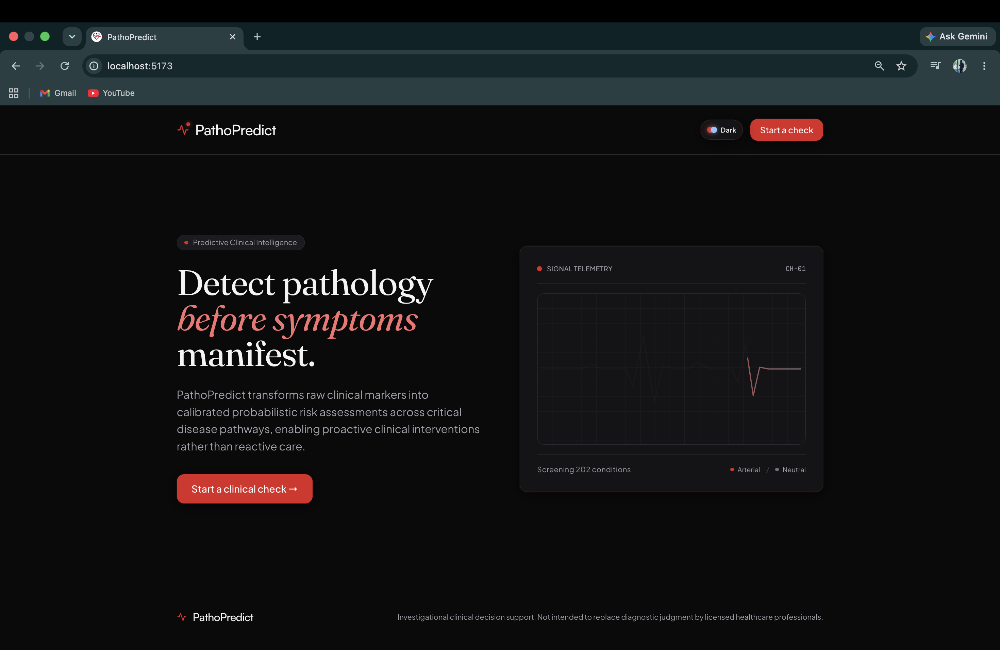
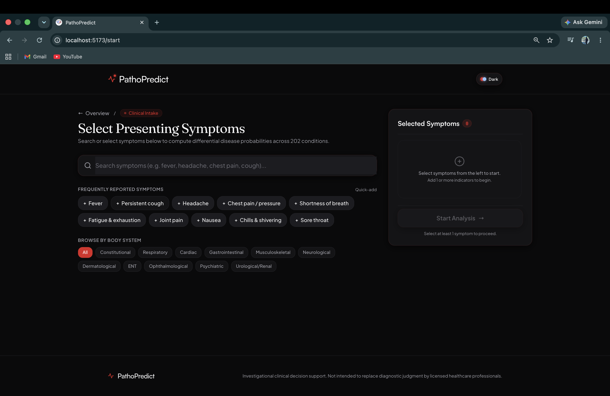
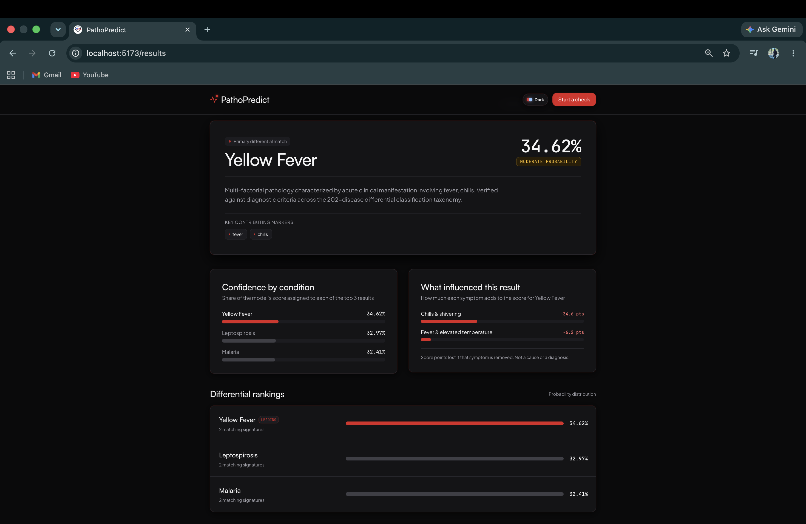
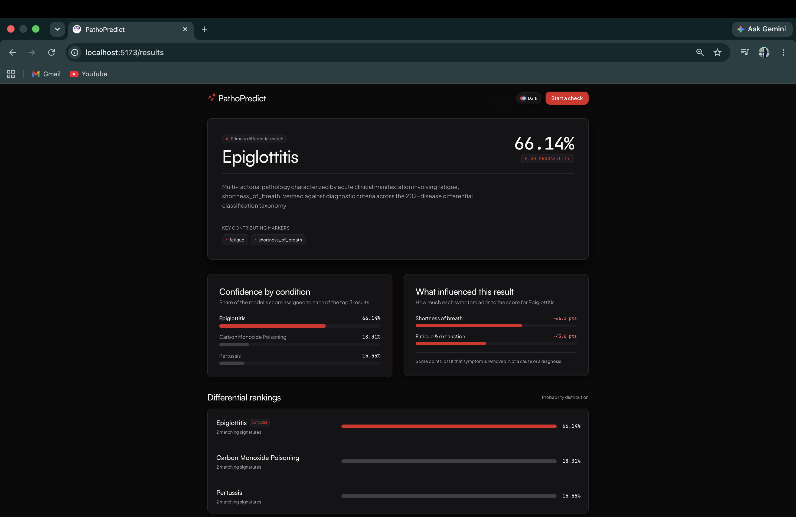

<p align="center">
  
</p>

<h1 align="center">PathoPredict</h1>

<p align="center">
  <strong>Calibrated Symptom-Based Differential Diagnosis & Disease Prediction System</strong>
</p>

<p align="center">
  <a href="#tech-stack"></a>
  <a href="#tech-stack"></a>
  <a href="#tech-stack"></a>
  <a href="#tech-stack"></a>
  <a href="#tech-stack"></a>
  <a href="#tech-stack"></a>
  <a href="#tech-stack"></a>
</p>

<p align="center">
  <a href="#overview">Overview</a> •
  <a href="#tech-stack">Tech Stack</a> •
  <a href="#architecture">Architecture</a> •
  <a href="#features">Features</a> •
  <a href="#interface-preview">Interface Preview</a> •
  <a href="#ml-pipeline">ML Pipeline</a> •
  <a href="#api-reference">API Reference</a> •
  <a href="#getting-started">Quick Start</a> •
  <a href="#team">Team</a>
</p>

---

> [!WARNING]
> **Clinical & Regulatory Disclaimer**: PathoPredict is an academic decision-support and clinical research prototype developed as an undergraduate major project. It does **not** provide professional medical advice, clinical diagnoses, treatment plans, or emergency triage recommendations. Always consult a licensed medical professional for health concerns.

---

## Overview

Clinical diagnosis is frequently complicated by symptomatic overlap: ubiquitous indicators such as fatigue, headache, and fever appear across dozens of distinct conditions spanning infectious, cardiac, neurological, and metabolic etiologies. **PathoPredict** addresses this multi-class discrimination challenge by mapping patient-reported symptom constellations to calibrated probabilistic differential hypotheses.

Given a validated set of symptom inputs, the application computes:
- **Ranked Top-3 Differential Diagnoses**: Evidence-weighted likelihood scores across 202 potential pathologies.
- **Primary Hypothesis Characterization**: Clinical urgency badge (`High`, `Moderate`, `Low`) and a pathophysiological summary.
- **Hallmark Indicator Correlation**: Direct alignment of patient symptoms with disease prototype profiles.
- **Deterministic Red-Flag Safety System**: Real-time rule-based evaluation detecting acute emergencies (e.g., myocardial infarction, severe mucosal hemorrhage, stroke/focal deficits) independent of model probabilities.
- **Recommended Diagnostic Tests**: Confirmatory laboratory and radiological workups associated with the candidate disease.

---

## Tech Stack

<p align="center">
  <a href="https://skillicons.dev">
    
  </a>
</p>

### Detailed Technology Breakdown

| Domain | Technology / Library | Logo / Badge | Version | Role in PathoPredict |
| :--- | :--- | :---: | :---: | :--- |
| **Frontend Framework** | **React** |  | `^18.3.1` | Declarative UI, functional component architecture, and custom hooks. |
| **Language (Client)** | **TypeScript** |  | `~5.x` | End-to-end type safety, domain model contracts, and compile-time verification. |
| **Build & Dev Server** | **Vite** |  | `^6.1.1` | Ultra-fast HMR and seamless `/api/*` reverse proxying to the FastAPI daemon. |
| **Styling & Design System** | **Tailwind CSS** |  | `^3.4.19` | Editorial dark-mode theme tokens, custom CSS variables, and responsive layout. |
| **Client Routing** | **React Router** |  | `^7.18.3` | SPA navigation, intake state routing, and history management. |
| **CSS Processing** | **PostCSS & Autoprefixer** |  | `^8.5.28` | CSS compilation, cross-browser vendor prefixing, and style tree optimization. |
| **Frontend Linter** | **Oxlint** |  | `^1.81.0` | High-performance Rust-based static code analysis and linting. |
| **Backend Framework** | **FastAPI** |  | `>=0.115.0` | Asynchronous high-throughput RESTful API microservice with OpenAPI auto-docs. |
| **ASGI Server** | **Uvicorn** |  | `>=0.30.0` | Asynchronous web server implementation for FastAPI with auto-reload. |
| **Data Validation** | **Pydantic** |  | `>=2.7.0` | Strict request/response serialization, type coercion, and schema enforcement. |
| **Machine Learning** | **scikit-learn** |  | `>=1.5.0` | Random Forest classifier, LabelEncoder, and multi-class probability scoring. |
| **Model Serialization** | **Joblib** |  | `>=1.4.0` | Optimized disk serialization and loading of trained estimators and vectors. |
| **Array Computing** | **NumPy** |  | `>=1.26.0` | Vectorized indicator calculations and multi-class probability arrays. |
| **Data Manipulation** | **Pandas** |  | `>=2.2.0` | Dataframe transformations, category matrix harmonization, and feature parsing. |
| **HTTP Client (Testing)** | **HTTPX** |  | `>=0.28.0` | Asynchronous HTTP client for backend test suite and verification. |
| **Backend Testing** | **Pytest** |  | `>=8.x` | Unit testing, integration validation, and boundary assertion harness. |
| **Version Control & Dev** | **Git & GitHub** |   | `Latest` | Distributed version control, collaborative development, and release tracking. |

---

## Architecture

PathoPredict is designed with a decoupled architecture separating UI state management from ML inference:

```
[ React + TypeScript Frontend (Port 5173) ]
                     │
            POST /api/predict  (Vite Reverse Proxy)
                     ▼
[ FastAPI Inference Microservice (Port 8000) ]
         │                               │
         ▼                               ▼
[ Rule-Based Red Flags ]    [ 122-Feature Indicator Vector ]
(check_critical_alert)                   │
         │                               ▼
         │                 [ model.joblib (Random Forest) ]
         │                               │
         │                               ▼
         │                 [ label_encoder.joblib (202 Classes) ]
         │                               │
         └───────────────┬───────────────┘
                         ▼
        [ reference_data.json Clinical Enrichment ]
                         │
                         ▼
    [ Top-3 Differential + Safety Alerts JSON Payload ]
                         │
                         ▼
      [ Client Differential Calibration & Visualization ]
```

### Request Lifecycle
1. **Intake & Validation**: User selects symptoms in the UI; keys are verified against the canonical 122-item vocabulary.
2. **Proxy Dispatch**: The Vite client proxies `POST /api/predict` to `http://localhost:8000`.
3. **Dual Processing**:
   - **ML Pipeline**: Transforms selected keys into a 122-length binary vector, queries the Random Forest classifier (`model.joblib`), and decodes disease labels (`label_encoder.joblib`).
   - **Safety Rules**: Evaluates acute presentation indicators (e.g., chest pain + dyspnea, focal neurological deficits) independently of model probabilities to guarantee triage safety.
4. **Clinical Enrichment**: Adds pathophysiological summaries and recommended lab tests from `reference_data.json`.
5. **Fallback Resilience**: If the backend is offline, an in-browser heuristic engine (`fallbackHeuristicPredict`) automatically activates, ensuring zero downtime.

---

## Features

- 🩺 **Split-View Intake Interface (`/start`)**: Desktop two-column dashboard with live search, 11 organ-system category filters, quick-select symptom chips, and a sticky selection sidebar with real-time counters.
- 📱 **Mobile Responsive Action Bar**: Sticky bottom panel ensuring analysis triggers remain accessible on small viewports without vertical scrolling.
- ⚡ **Dual-Engine Prediction Pipeline**: Primary inference via FastAPI (`POST /api/predict`) with an automatic client-side heuristic fallback engine ensuring uninterrupted continuity.
- 📊 **Calibrated Probability Distributions**: Normalizes multi-class outputs across wide label spaces to ensure evidence-proportional clinical probabilities.
- 🚨 **Deterministic Red-Flag Safety System**: Independent rule-based evaluation detecting acute, life-threatening symptoms and escalating triage urgency to `High`.
- 📋 **Diagnostic Results Dashboard (`/results`)**: Displays primary candidate details, descending differential comparison bars, matched indicators, and confirmatory lab tests.
- 🌓 **Adaptive Theming**: Seamless dark and light modes with custom CSS tokens and SVG styling.
- 🩺 **Diagnostic Health Check (`/api/health`)**: Diagnostic endpoint reporting active model status, total loaded features (122), and diagnosable disease classes (202).

---

## Interface Preview

<div align="center">
  <h3>1. Clinical Landing Page & Real-Time Signal Telemetry</h3>
  <p><em>Predictive clinical intelligence entry point with real-time signal telemetry visualization.</em></p>
  
  <br /><br /><br />

  <h3>2. Symptom Intake Dashboard & Organ-System Taxonomy</h3>
  <p><em>Searchable 122-symptom catalog across 11 organ systems with quick-add chips and active selection panel.</em></p>
  
  <br /><br /><br />

  <h3>3. Differential Diagnosis & Symptom Influence Attribution (Moderate Urgency)</h3>
  <p><em>Candidate probability breakdown, symptom contribution points, and differential rankings (Yellow Fever).</em></p>
  
  <br /><br /><br />

  <h3>4. High-Probability Acute Presentation & Confidence Scoring (High Urgency)</h3>
  <p><em>Acute differential analysis with key contributing markers and diagnostic ranking distributions (Epiglottitis).</em></p>
  
</div>

---

## ML Pipeline

### 1. Clinical Data Sources
Raw clinical data is compiled from 15 organ-specific symptom matrices in `backend/ml/data/raw/`:
* `cardiac_diseases_symptoms_matrix.csv`, `respiratory.csv`, `neurological_diseases1.csv`, `gastrointestinal.csv`, `endocrine_metabolic.csv`, `hematological_bleeding_bruising.csv`, `joint_and_muscle_pain.csv`, `urinary_renal.csv`, `skin_rash_dermatological.csv`, `eye_related_redness_pain_vision.csv`, `ear_nose_throat_dizziness_hearing.csv`, `sore_throat_fever_upper_respiratory.csv`, `viral_flu_like.csv`, `headache_predominant.csv`, and `mental_health12_.csv`.

### 2. Standardization & Merging
* `standardize.py` defines an alias dictionary mapping irregular source columns to a unified vocabulary of **122 canonical symptom identifiers**.
* `merge_datasets.py` unifies all 15 sources into `combined_dataset.csv`, imputing unrecorded symptoms as $0$, yielding **202 distinct disease labels**.

### 3. Synthetic Cohort Generation
Raw matrices represent disease prototypes rather than individual patient records. The pipeline (`generate_augmented_patient_cohort` in `train_flat_eval.py`) generates 35 simulated patient presentations per disease prototype (7,070 total rows):
* **Sensitivity Dropout**: 10%–15% stochastic omission of prototype symptoms to simulate incomplete presentations.
* **Background Noise**: 2.5% random activation probability on absent symptoms to simulate non-specific complaints.
* **SMOTE Resampling**: Applied strictly within training folds during cross-validation.

### 4. Cross-Validation & Model Comparison
Models were evaluated using Stratified 5-Fold Cross-Validation (`random_state=42`):

| Model | Accuracy (Mean ± Std) | Macro Precision | Macro Recall | Macro F1-Score |
| :--- | :---: | :---: | :---: | :---: |
| 🌲 **Random Forest (Production)** | **78.31% ± 1.31%** | **78.82% ± 1.27%** | **78.38% ± 1.38%** | **77.63% ± 1.42%** |
| 📊 Naive Bayes (Bernoulli) | 75.36% ± 0.90% | 77.71% ± 0.90% | 76.60% ± 0.98% | 76.18% ± 0.97% |
| 🌿 Decision Tree | 60.67% ± 1.40% | 62.92% ± 1.67% | 60.69% ± 1.47% | 60.25% ± 1.57% |

Top features by importance: `fatigue` (3.67%), `fever` (3.05%), `headache` (2.67%), `nausea` (2.50%), and `skin_rash` (2.14%).

---

## API Reference

### `POST /api/predict`
Evaluates submitted symptom keys and returns ranked differential hypotheses, safety alerts, and lab recommendations.

* **Path**: `/api/predict` (alias: `/predict`)
* **Method**: `POST`
* **Request Body**:
```json
{
  "symptom_keys": ["fever", "headache", "joint_pain"]
}
```
*(Note: `symptom_ids` is supported as an alias for backward compatibility)*

* **Response Body (`200 OK`)**:
```json
{
  "top_match": {
    "disease": "Dengue Fever",
    "probability": 48.5,
    "risk_badge": "High",
    "pathophysiology_summary": "Arboviral infection causing acute febrile illness, severe thrombocytopenia, and plasma leakage risk.",
    "key_symptoms": ["fever", "headache", "joint_pain"],
    "recommended_lab_tests": [
      "CBC / Platelet Count",
      "Dengue NS1 Antigen",
      "Dengue IgM/IgG"
    ],
    "reference_data_complete": true
  },
  "differential": [
    {
      "disease": "Dengue Fever",
      "probability": 48.5,
      "risk_badge": "High",
      "key_symptoms": ["fever", "headache", "joint_pain"]
    },
    {
      "disease": "Chikungunya",
      "probability": 32.1,
      "risk_badge": "Moderate",
      "key_symptoms": ["fever", "joint_pain"]
    },
    {
      "disease": "Viral Infection",
      "probability": 19.4,
      "risk_badge": "Low",
      "key_symptoms": ["fever", "headache"]
    }
  ],
  "critical_alert": null,
  "recommended_lab_tests": [
    "CBC / Platelet Count",
    "Dengue NS1 Antigen",
    "Dengue IgM/IgG"
  ],
  "reference_data_complete": true
}
```

### `GET /api/health`
Health check and runtime metadata endpoint.

* **Response Body (`200 OK`)**:
```json
{
  "status": "healthy",
  "service": "PathoPredict Clinical API",
  "total_canonical_symptoms": 122,
  "total_disease_classes": 202
}
```

---

## Getting Started

### Prerequisites
- **Python 3.10+** (tested on 3.10, 3.12, 3.13)
- **Node.js 18+** and **npm**
- **Git**

---

### Step-by-Step Installation

#### 1. Clone the Repository
```bash
git clone https://github.com/SameerAhmadKhan01/PathoPredict.git
cd PathoPredict
```

#### 2. Start the FastAPI Backend (Port 8000)
Open your first terminal window:

```bash
# Activate virtual environment (or create one: python3 -m venv backend/venv)
source backend/venv/bin/activate
# On Windows PowerShell: .\backend\venv\Scripts\Activate.ps1

# Install backend dependencies
pip install -r backend/requirements.txt pytest

# Start Uvicorn ASGI server
uvicorn app.main:app --app-dir backend --port 8000 --reload
```
> **Verification**: Check for `[INFO] PathoPredict: PATHOPREDICT CLINICAL INFERENCE SERVICE READY` and `Uvicorn running on http://127.0.0.1:8000`.

#### 3. Start the React Frontend (Port 5173)
Open a second terminal window:

```bash
cd frontend

# Install npm packages
npm install

# Start Vite dev server
npm run dev
```
> **Verification**: Open **`http://localhost:5173`** in your browser. All `/api/*` requests are automatically proxied to port 8000.

---

### Optional: Model Switching
Switch to the soft-voting ensemble model (`models_v2`) at launch using the `MODEL_DIR` environment variable:

```bash
MODEL_DIR=backend/ml/models_v2 uvicorn app.main:app --app-dir backend --port 8000 --reload
```

---

## Testing & Quality Assurance

### Run Backend Tests (Pytest)
```bash
# Run all tests
pytest -v backend/tests/
```
The test suite validates:
- Complete coverage of all 202 diseases in `reference_data.json`.
- Strict 422 validations on unrecognized symptom tokens.
- Descending probability invariants in differential outputs.
- Deterministic escalation of critical alerts.

### Run Frontend Typechecks & Linting
```bash
cd frontend

# TypeScript compilation check
npm run build

# Static code linting
npm run lint
```

---

## Troubleshooting

| Issue / Error | Probable Cause | Recommended Resolution |
| :--- | :--- | :--- |
| `[vite] http proxy error: /api/predict AggregateError [ECONNREFUSED]` | FastAPI backend on port `8000` is stopped or crashed. | Open a terminal and run `source backend/venv/bin/activate && uvicorn app.main:app --app-dir backend --port 8000 --reload`. |
| Unresolved Python imports in VS Code | VS Code is using the global interpreter rather than the virtual environment. | Press `Cmd + Shift + P` $\rightarrow$ **Python: Select Interpreter** $\rightarrow$ choose `./backend/venv/bin/python`. |
| Port `8000` already in use | An orphaned Uvicorn process is still running in the background. | Run `lsof -i :8000` and `kill -9 <PID>` before restarting Uvicorn. |

---

## Limitations

1. **Symptom Absence Assumption**: Unchecked symptoms are assumed absent ($0$), conflating unrecorded clinical data with confirmed negative findings.
2. **Synthetic Cohort Training**: The model is trained on perturbed synthetic patient presentations rather than primary electronic health records (EHR).
3. **Vocabulary Boundary**: Restricted strictly to the 122 canonical symptom tokens defined in `symptom_columns.joblib`.
4. **Research Only**: Has not undergone prospective clinical trials, peer-reviewed clinical validation, or regulatory approval.

---

## Team

Developed as a BTech Major Project by:

- **Sameer Ahmad Khan**
- **Rudra Gautam**
- **Sahitya Bhaumik**
- **Saishreeya Mohanty**
- **Samrat Dutta**

---

<p align="center">
  <sub>Built with ❤️ for clinical decision-support and machine learning research.</sub>
</p>
