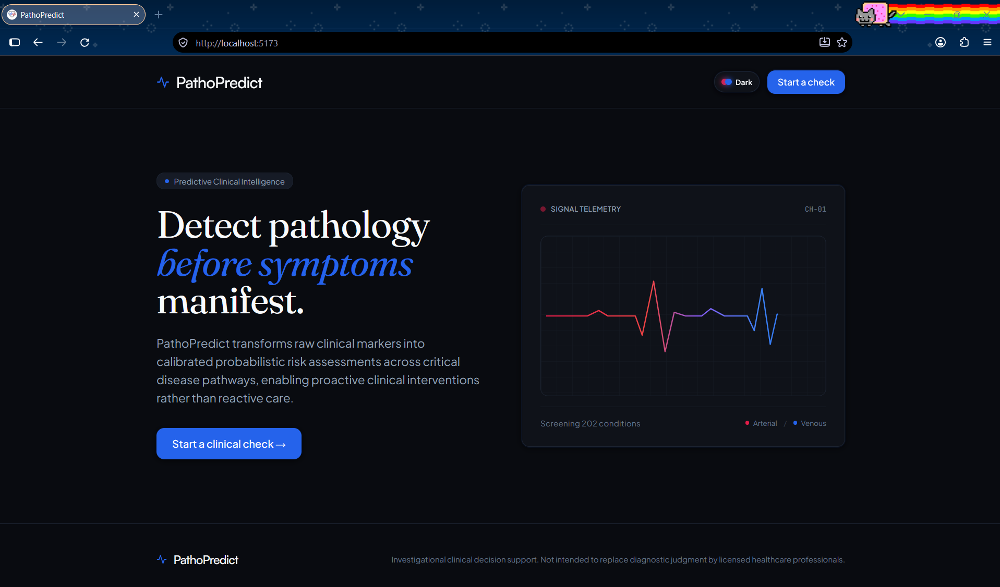
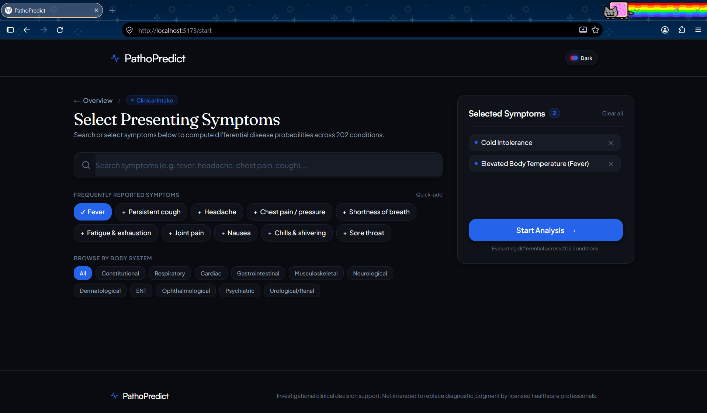
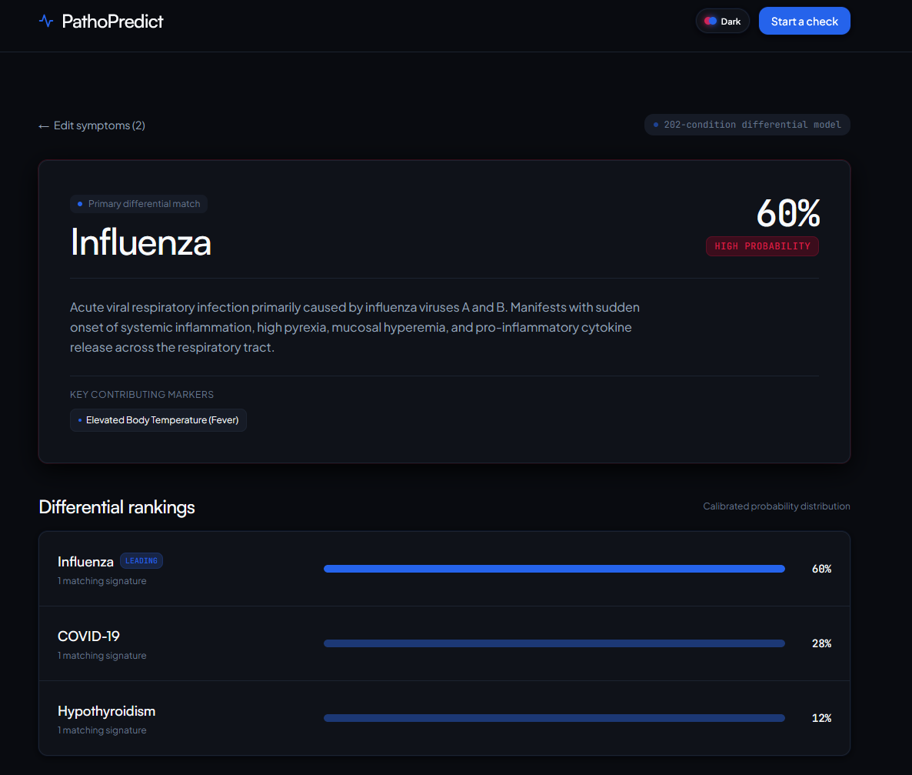

# PathoPredict

Calibrated symptom-based disease prediction and differential diagnosis system.

> **Medical Notice**: PathoPredict is an academic, non-clinical research project and clinical decision-support prototype. It does not provide medical diagnoses, treatment plans, or clinical triage advice. Always consult a licensed healthcare professional for medical concerns.

---

## Overview

Clinical diagnosis is frequently complicated by symptomatic overlap across pathologies: ubiquitous indicators such as fatigue, headache, and fever appear across dozens of distinct conditions spanning infectious, cardiac, neurological, and metabolic etiologies. PathoPredict addresses this multi-class discrimination challenge by mapping patient-reported symptom constellations to probabilistic differential hypotheses.

Given a validated set of symptom inputs, the application computes:
- **Ranked Top-3 Differential Diagnoses**: Probabilistic likelihood scores across candidate conditions.
- **Primary Hypothesis Characterization**: Clinical urgency risk badge (`High`, `Moderate`, `Low`) and a pathophysiological summary.
- **Key Contributing Symptoms**: Exact patient-reported symptoms that match the disease prototype.
- **Critical Red-Flag Alerts**: Deterministic clinical safety rules that evaluate emergency presentations (such as acute coronary syndrome, acute dyspnea, stroke/focal neurological deficits, or severe mucosal bleeding) independent of model confidence.
- **Recommended Diagnostic Tests**: Confirmatory laboratory and diagnostic investigations associated with the candidate disease.

**System Limitations**: PathoPredict operates on a discrete binary feature vocabulary (122 symptoms across 202 diseases) derived from reference symptom matrices and synthetic patient cohorts. It assumes unrecorded symptoms are absent ($0$) and has not undergone prospective clinical trials or regulatory validation.

---

## Features

- **Split-View Intake Interface (`/start`)**: Desktop two-column dashboard with live search, 11 organ-system category filters, quick-select symptom chips, and a sticky selection sidebar with real-time counters and dismiss controls.
- **Mobile Responsive Action Bar**: Sticky bottom panel ensuring analysis triggers remain accessible on small viewports without vertical scrolling.
- **Dual-Engine Prediction Pipeline**: Primary inference via FastAPI (`POST /api/predict`), with an automatic client-side heuristic fallback engine ensuring continuity if the backend service is offline.
- **Calibrated Probability Distributions**: Normalizes multi-class outputs to prevent flat confidence distributions across wide label spaces.
- **Deterministic Red-Flag Safety System**: Independent rule-based evaluation detecting acute, life-threatening symptoms and escalating triage urgency to `High`.
- **Diagnostic Results Dashboard (`/results`)**: Displays primary candidate details, descending differential comparison bars, matched indicators, and confirmatory lab tests.
- **Theming**: Toggleable dark and light modes with custom CSS tokens and SVG styling.
- **Service Health Check (`/api/health`)**: Diagnostic endpoint reporting active model status, total loaded features (122), and diagnosable disease classes (202).

---

## Screenshots

<!-- TODO: Add application screenshots to docs/screenshots/start.png and docs/screenshots/results.png -->
<p align="center">
  
</p>
<p align="center">
  
</p>
<p align="center">
  
</p>

---

## Tech Stack

<p align="center">
  
</p>
<p align="center">
  
</p>
<p align="center">
  
</p>
<p align="center">
  
</p>

---

## Architecture

PathoPredict is architected as a decoupled single-page application and RESTful microservice. The React frontend collects validated symptom keys and dispatches an HTTP POST request to `/api/predict`. In local development, the Vite development server proxies requests from port `5173` to the FastAPI backend running on Uvicorn at port `8000`. The backend validates incoming tokens against the canonical 122-symptom vocabulary, constructs an indicator feature vector, runs rule-based red flag evaluations, and queries the serialized Random Forest classifier (`model.joblib`) and label encoder (`label_encoder.joblib`). Predictions are enriched with clinical reference summaries from `reference_data.json` before being returned to the client.

```
[ React + TypeScript Frontend (Port 5173) ]
                     │
            POST /api/predict
                     ▼
[ FastAPI Inference Service (Port 8000) ]
        │                        │
        ▼                        ▼
[ Rule-Based Red Flags ]    [ Feature Vector (122 cols) ]
        │                        │
        │                        ▼
        │              [ model.joblib (Random Forest) ]
        │                        │
        │                        ▼
        │              [ label_encoder.joblib (202 classes) ]
        │                        │
        └────────────────┬───────┘
                         ▼
        [ reference_data.json Enrichment ]
                         │
                         ▼
    [ Top-3 Differential + Critical Alert JSON ]
```

---

## Project Structure

```
PathoPredict/
├── backend/
│   ├── app/
│   │   ├── data/                 # Clinical reference data scaffold (reference_data.json)
│   │   ├── routers/              # API route definitions (predict.py)
│   │   ├── schemas/              # Pydantic request and response schemas (prediction.py)
│   │   ├── services/             # Feature vector builder, ML inference, reference data, and risk rules
│   │   └── main.py               # FastAPI application setup, CORS middleware, and lifespan assertions
│   ├── ml/
│   │   ├── data/
│   │   │   ├── raw/              # 15 category symptom matrix CSVs
│   │   │   └── processed/        # Merged dataset and simulated patient cohorts
│   │   ├── logs/                 # Data preparation logs and Stratified K-Fold CV metrics report
│   │   ├── models/               # Serialized model, label encoder, and feature columns (.joblib)
│   │   ├── merge_datasets.py     # Unification script combining raw CSVs into combined_dataset.csv
│   │   ├── standardize.py        # Vocabulary normalization and symptom alias definitions
│   │   └── train_flat_eval.py    # Stratified 5-Fold CV training, SMOTE oversampling, and artifact export
│   ├── tests/                    # Pytest test suite (prediction and reference data tests)
│   └── requirements.txt          # Python dependencies
├── frontend/
│   ├── src/
│   │   ├── assets/               # Static images and vector icons
│   │   ├── components/           # UI components (Header, Footer, Hero, ThemeToggle)
│   │   ├── contexts/             # ThemeContext provider for dark/light theme state
│   │   ├── data/                 # Canonical symptoms catalog (122 items) and organ-system groupings
│   │   ├── pages/                # Route views (LandingPage, StartPage, ResultsPage, SignInPage)
│   │   ├── services/             # API client and calibrated client-side fallback engine
│   │   ├── App.tsx               # Route declarations
│   │   └── main.tsx              # React DOM root entry point
│   ├── package.json              # Frontend scripts and npm package dependencies
│   ├── tailwind.config.js        # Design tokens and Tailwind utility configuration
│   └── vite.config.ts            # Vite build configuration and backend API proxy
└── README.md                     # Project documentation
```

---

## ML Pipeline

### 1. Data Sources
The dataset originates from clinical symptom-matrix CSVs across organ systems located in `backend/ml/data/raw/`:
- Category matrices: `cardiac_diseases_symptoms_matrix.csv`, `ear_nose_throat_dizziness_hearing.csv`, `eye_related_redness_pain_vision.csv`, `headache_predominant.csv`, `hematological_bleeding_bruising.csv`, `mental_health12_.csv`, `neurological_diseases1.csv`, `skin_rash_dermatological.csv`, `sore_throat_fever_upper_respiratory.csv`, `endocrine_metabolic.csv`, `gastrointestinal.csv`, `joint_and_muscle_pain.csv`, `respiratory.csv`, `urinary_renal.csv`, and `viral_flu_like.csv`.

### 2. Standardization & Merging
The `standardize.py` module defines an alias dictionary mapping non-uniform column names to a unified vocabulary of 122 canonical symptom identifiers (e.g., `Chest Pain / Pressure` and `Chest_Pain` map to `chest_pain`; `Fever / Chills` maps to `fever`). Merging via `merge_datasets.py` unifies all 15 sources into `combined_dataset.csv`, filling missing indicators with $0$, yielding 202 distinct disease labels.

### 3. Class-Imbalance & Synthetic Cohort Generation
Because raw clinical matrices contain prototype rows rather than individual patient records, direct multi-class training on single-row classes would cause severe overfitting. The pipeline (`generate_augmented_patient_cohort` in `train_flat_eval.py`) generates 35 simulated patient presentations per disease prototype (7,070 total rows):
- **Sensitivity Dropout**: 10%–15% stochastic omission of prototype symptoms to simulate incomplete or atypical presentations.
- **Background Noise**: 2.5% random activation probability on absent symptoms to simulate common non-specific complaints.
- **SMOTE Resampling**: Applied strictly within training folds during cross-validation (`k_neighbors=2` or `min_count - 1`).

### 4. Cross-Validation & Model Comparison
Models were evaluated using Stratified 5-Fold Cross-Validation (`random_state=42`). Metrics from `backend/ml/logs/cv_evaluation_report.json`:

| Model | Accuracy (Mean ± Std) | Macro Precision | Macro Recall | Macro F1-Score |
|---|---|---|---|---|
| **Random Forest** | **78.31% ± 1.31%** | **78.82% ± 1.27%** | **78.38% ± 1.38%** | **77.63% ± 1.42%** |
| Naive Bayes (Bernoulli) | 75.36% ± 0.90% | 77.71% ± 0.90% | 76.60% ± 0.98% | 76.18% ± 0.97% |
| Decision Tree | 60.67% ± 1.40% | 62.92% ± 1.67% | 60.69% ± 1.47% | 60.25% ± 1.57% |

The top 5 most informative features identified by Random Forest feature importance are `fatigue` (3.67%), `fever` (3.05%), `headache` (2.67%), `nausea` (2.50%), and `skin_rash` (2.14%).

### 5. Final Model Artifacts & Retraining
The production model is a Random Forest Classifier (`n_estimators=150`, `random_state=42`) serialized with joblib.

To retrain the model and regenerate all artifacts:
```bash
# 1. Compile and standardize raw matrices into combined_dataset.csv
python backend/ml/merge_datasets.py

# 2. Generate augmented cohort, evaluate CV, and export model artifacts
python backend/ml/train_flat_eval.py
```
Generated artifacts are saved to `backend/ml/models/`:
- `symptom_columns.joblib`: List of 122 ordered canonical symptom names.
- `label_encoder.joblib`: Scikit-learn LabelEncoder covering all 202 disease classes.
- `flat_disease_model.joblib` / `model.joblib`: Trained Random Forest classifier.

---

## API Reference

### `POST /api/predict`
Evaluates validated symptom keys and returns ranked differential diagnoses, critical safety alerts, and lab recommendations.

- **Path**: `/api/predict` (alias: `/predict`)
- **Method**: `POST`
- **Request Body**:
```json
{
  "symptom_keys": ["fever", "headache", "joint_pain"]
}
```
*(Note: `symptom_ids` is accepted as an alias for backward compatibility)*

- **Response Body (`200 OK`)**:
```json
{
  "top_match": {
    "disease": "Dengue Fever",
    "probability": 48.5,
    "risk_badge": "High",
    "pathophysiology_summary": "Reference data pending clinical review",
    "key_symptoms": ["fever", "headache", "joint_pain"],
    "recommended_lab_tests": ["CBC / Platelet Count", "Dengue NS1 Antigen", "Dengue IgM/IgG"],
    "reference_data_complete": true
  },
  "differential": [
    {
      "disease": "Dengue Fever",
      "probability": 48.5,
      "risk_badge": "High",
      "key_symptoms": ["fever", "headache", "joint_pain"]
    },
    {
      "disease": "Chikungunya",
      "probability": 32.1,
      "risk_badge": "Moderate",
      "key_symptoms": ["fever", "joint_pain"]
    },
    {
      "disease": "Viral Infection",
      "probability": 19.4,
      "risk_badge": "Low",
      "key_symptoms": ["fever", "headache"]
    }
  ],
  "critical_alert": null,
  "recommended_lab_tests": ["CBC / Platelet Count", "Dengue NS1 Antigen", "Dengue IgM/IgG"],
  "reference_data_complete": true
}
```

- **Error Responses**:
  - `422 Unprocessable Entity`: Raised if `symptom_keys` is empty or contains items not present in `symptom_columns.joblib`.
  - `500 Internal Server Error`: Unhandled model inference exception.

---

### `GET /api/health`
Health check and model status endpoint.

- **Path**: `/api/health` (alias: `/health`)
- **Method**: `GET`
- **Response Body (`200 OK`)**:
```json
{
  "status": "healthy",
  "service": "PathoPredict Clinical API",
  "total_canonical_symptoms": 122,
  "total_disease_classes": 202
}
```

---

## Getting Started

### Prerequisites
- Python 3.10+ (tested on Python 3.13)
- Node.js 18+ and npm
- Git

### Backend Setup
```bash
# 1. Navigate to the backend directory
cd backend

# 2. Create and activate a Python virtual environment
python -m venv venv

# Windows (PowerShell):
.\venv\Scripts\Activate.ps1
# Linux/macOS:
source venv/bin/activate

# 3. Install required Python packages
pip install -r requirements.txt

# 4. Environment Variables
# TODO: No .env.example exists in the backend. Currently no external environment variables are required for local inference.

# 5. Model Artifacts Verification (optional retraining if artifacts are absent)
python ml/merge_datasets.py
python ml/train_flat_eval.py

# 6. Run the FastAPI development server
uvicorn app.main:app --host 0.0.0.0 --port 8000 --reload
```

### Frontend Setup
```bash
# 1. Navigate to the frontend directory
cd frontend

# 2. Install npm dependencies
npm install

# 3. Environment Variables
# TODO: No .env.example exists in the frontend. Vite proxies /api directly to http://localhost:8000 via vite.config.ts.

# 4. Start Vite development server
npm run dev
```

### Running Both Together
Run the backend on port `8000` (`http://localhost:8000`) and the frontend on port `5173` (`http://localhost:5173`). Vite is configured to automatically proxy `/api` calls to `http://localhost:8000`. Open `http://localhost:5173` in a browser.

---

## Testing

### Backend Test Suite
The backend contains a test suite written in pytest:

```bash
# From the repository root (with backend virtual environment activated):
pytest backend/tests/

# Or with verbose logging:
pytest -v backend/tests/
```

Test coverage includes:
- `backend/tests/test_predict.py`: Verifies response schema structures, probability descending order, clinical scenarios (GERD, Stable Angina, Common Cold), 422 validations on empty or unrecognized symptoms, and rule-based red flag alert escalations.
- `backend/tests/test_reference_data.py`: Asserts that all 202 disease classes from `label_encoder.joblib` have valid entries in `reference_data.json` and checks placeholder fallback safety.

### Frontend Quality Checks
```bash
cd frontend

# Type-checking and bundle compilation
npm run build

# Static lint analysis
npm run lint

# TODO: Frontend unit test suite (e.g., Vitest or Jest) is not yet configured in package.json.
```

---

## Dataset and Limitations

### Data Provenance
Data is compiled from 15 symptom-disease category matrices under `backend/ml/data/raw/` detailing binary symptom presences across organ-specific diseases.

### Known Limitations
1. **Symptom Absence Assumption**: Any symptom not explicitly documented for a disease in the raw matrix is treated as $0$ (absent), conflating unrecorded clinical data with confirmed negative findings.
2. **Synthetic Patient Generation**: Supervised training is conducted on simulated patient vectors generated with synthetic dropout and perturbation rather than real-world electronic health records (EHR).
3. **Vocabulary Boundary**: The model only recognizes symptoms present in `symptom_columns.joblib` (122 tokens). Free-text narratives or symptoms outside this dictionary cannot be parsed directly without prior mapping.
4. **Non-Clinical Validation**: PathoPredict has not undergone clinical trials, diagnostic validation studies, or healthcare agency evaluations.

> **Disclaimer**: PathoPredict is strictly an academic demonstration and research tool. It must never be relied upon for medical decision-making, clinical diagnosis, or emergency triage.

---


## Team and Academic Context

BTech Major Project.

### Team Members
- Sameer Ahmad Khan (TODO: Add Roll Number / University Email)
- Rudra Gautam (TODO: Add Roll Number / University Email)
- Sahitya Bhaumik (TODO: Add Roll Number / University Email)
- Saishreeya Mohanty (TODO: Add Roll Number / University Email)

### Project Mentor
- TODO: Add Project Mentor / Guide Name and Designation

### Institution
- TODO: Add Department, Faculty, and University / Institute Name

---

## License

TODO: Add LICENSE file (No license file currently exists in the repository).
